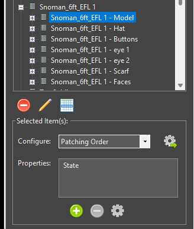
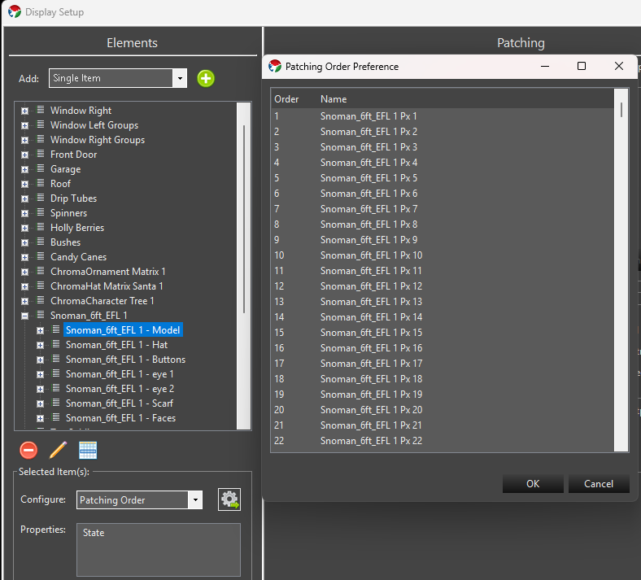
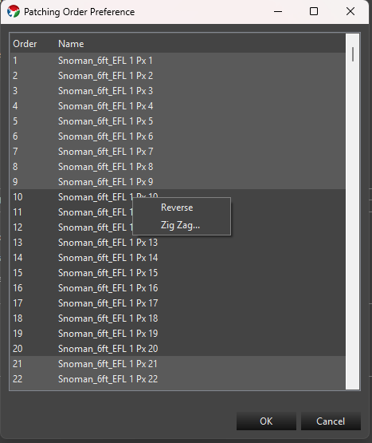
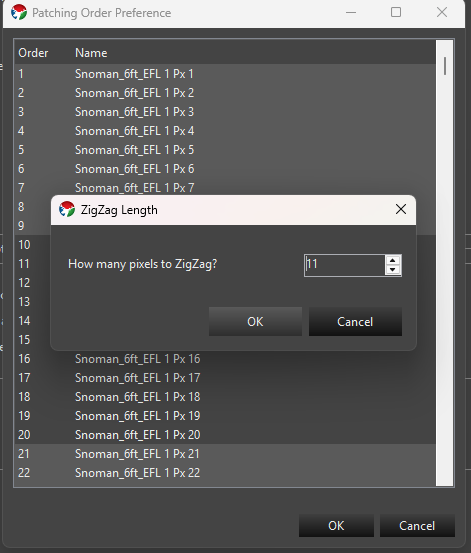
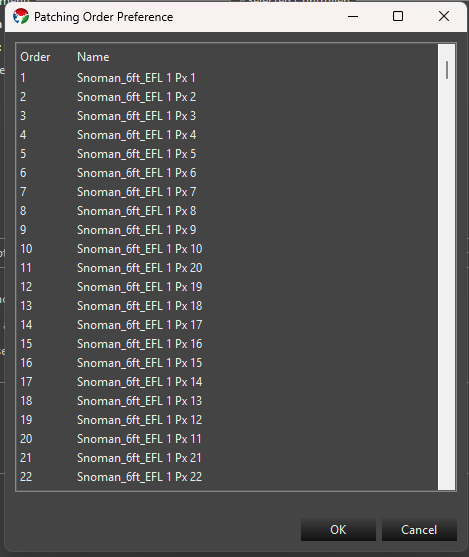
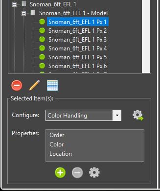
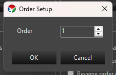

## Patching Order

When you patch a group of elements to controller outputs, Vixen normally patches them in the order they appear in the element tree. That is not always the order your lights are wired. A pixel grid wired in a serpentine pattern, or a tree where the strings were connected in a different sequence, will not match the tree order.

The Patching Order property lets you define the order independently of the element tree. Each element gets an order number, and when you patch, Vixen assigns the elements to outputs from the lowest order number to the highest. The order does not change the structure of your element tree or how your sequences look.

## Opening the Patching Order Helper

The Patching Order helper is opened the same way as the dimming curve wizard.

1. In Display Setup, select the elements you want to order. You can select groups; the helper works on all of the individual (leaf) elements within them.
2. Open the **Configure** drop down and choose **Patching Order**.

*Opening Patching Order from the Configure drop down.*

The helper shows a numbered list of the selected elements. If the elements already have an order, they are listed by that order. Elements that do not have an order yet are listed after those that do.

*The Patching Order dialog before any changes.*

## Reordering Elements

There are three ways to change the order in the list.

* **Drag and drop.** Drag one or more rows to a new position. The numbers update when you drop.
* **Reverse.** Select two or more rows, right click, and choose **Reverse**. The selected rows are listed in the opposite order.
* **Zig Zag.** Select two or more rows, right click, and choose **Zig Zag...**. This reverses every other block of the selected rows, which matches serpentine wiring.

You can press Ctrl+A to select all of the rows. Reverse and Zig Zag only appear in the right click menu when more than one row is selected.

*Reverse and Zig Zag are available when multiple rows are selected.*

When you click **OK**, the elements are numbered 1 through N in the order shown, and that number is saved as the element's Order property. **Cancel** leaves everything as it was.

### Reverse Example

Suppose you have a string of eight pixels that was wired starting from the end that is last in your element tree. The list starts out as:

| Order | Element |
|-------|---------|
| 1 | Pixel 1 |
| 2 | Pixel 2 |
| ... | ... |
| 8 | Pixel 8 |

Select all of the rows, right click, and choose **Reverse**. Pixel 8 is now first and Pixel 1 is last, so patching starts with Pixel 8.

### Zig Zag Example

Imagine a matrix of three columns with four pixels each, wired in a serpentine pattern. The first column is wired bottom to top, the second top to bottom, and the third bottom to top. The elements in the tree are named by column and are all listed bottom to top:

| Order | Element |
|-------|---------|
| 1 | Column 1 Pixel 1 |
| 2 | Column 1 Pixel 2 |
| 3 | Column 1 Pixel 3 |
| 4 | Column 1 Pixel 4 |
| 5 | Column 2 Pixel 1 |
| 6 | Column 2 Pixel 2 |
| 7 | Column 2 Pixel 3 |
| 8 | Column 2 Pixel 4 |
| 9 | Column 3 Pixel 1 |
| 10 | Column 3 Pixel 2 |
| 11 | Column 3 Pixel 3 |
| 12 | Column 3 Pixel 4 |

Select all twelve rows, right click, and choose **Zig Zag...**. You are asked how many pixels to zig zag.

*Enter the number of pixels in each run. For this example that is 4.*

Enter 4, the number of pixels in each column. The first run keeps its order and the second run is reversed. The third run keeps its order again, and so on. The result is:

| Order | Element |
|-------|---------|
| 1 | Column 1 Pixel 1 |
| 2 | Column 1 Pixel 2 |
| 3 | Column 1 Pixel 3 |
| 4 | Column 1 Pixel 4 |
| 5 | Column 2 Pixel 4 |
| 6 | Column 2 Pixel 3 |
| 7 | Column 2 Pixel 2 |
| 8 | Column 2 Pixel 1 |
| 9 | Column 3 Pixel 1 |
| 10 | Column 3 Pixel 2 |
| 11 | Column 3 Pixel 3 |
| 12 | Column 3 Pixel 4 |

*The list after applying Zig Zag.*

The number of selected rows must divide evenly by the zig zag length. If it does not, you will get an error and nothing is changed. If you only want to zig zag part of a list, select just the rows that make up complete runs.

## Patching with an Order

Once the elements have an order, patch them as you normally would. Select the elements and the controller outputs, and Vixen patches the elements in the order you defined.

If something about the order is not consistent, Vixen asks you about it before patching. This happens when:

* Some of the elements being patched have an order and some do not.
* Two or more elements have the same order number.

You can then choose to:

* **Yes** - open the Patching Order helper so you can fix the order.
* **No** - ignore the order and patch using the element tree order.
* **Cancel** - stop without patching.

If none of the elements being patched have an order, the element tree order is used and you are not prompted.

## Ordering Is Set Up Automatically for Some Props

When you create a **Megatree** or **Pixel Grid** from the element templates, Vixen sets the patching order for you based on the start location and, if you select it, the zig zag option. You only need to use the Patching Order helper if your wiring is different from what the template produced, or for elements you built in another way.

## Editing a Single Element's Order

The helper sets the order for many elements at once. The order is stored as a property on each element, so you can also view or edit it for a single element.

1. Select the element in Display Setup.
2. Look for **Order** in the Configuration list of properties.
3. Double click **Order**, or select it and click the gear icon, to open the **Order Setup** dialog. Enter the order number and click OK.

*The Order property in the Configuration properties list.*

If the element does not have an Order property yet, click the plus icon to add it. The Order Setup dialog opens so you can pick the number. To remove the Order from an element, select it in the properties list and click the minus icon. An element with no Order property is treated as having no preferred order.

*The Order Setup dialog.*

Be careful when typing order numbers by hand. Nothing stops you from giving two elements the same number, which will lead to the conflict prompt when you patch. For more than a few elements, the Patching Order helper is easier and keeps the numbers unique.

## Patching Order vs. Reverse Element Order

The patching screen has an option to reverse the element order at the time you patch. In general, you should not use that option together with a patching order. Choose one approach and stick with it. Setting the order in reverse using the Patching Order helper (the **Reverse** menu item) is the better method. The order is saved with the elements, so the result is the same every time you patch and anyone looking at the setup can see how it was meant to be wired. Using the reverse option while also having an order set can give you a result that is the opposite of what you expect.
